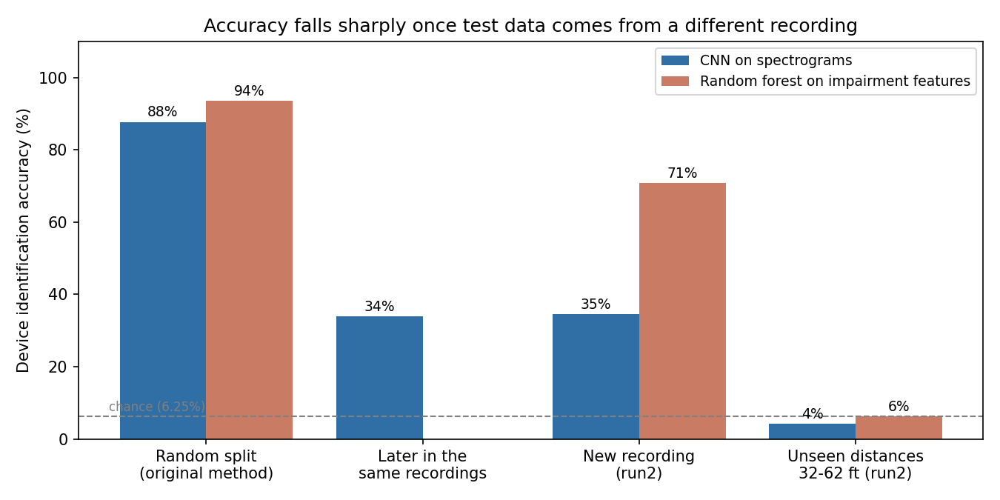
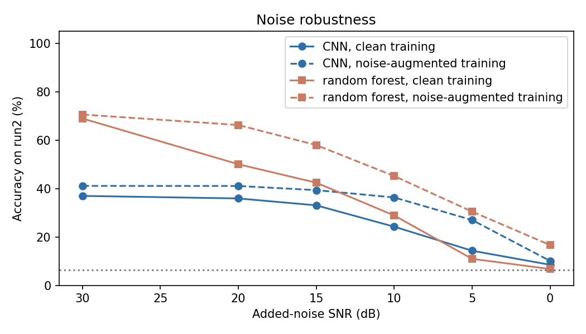

# RF Fingerprinting for Device Authentication

Can a radio be recognised by the tiny imperfections in its hardware, so that a device with cloned keys, certificates or MAC address is still caught? This project tests that on **16 USRP X310 transmitters** from the ORACLE dataset. It also checks how much of a model's accuracy survives an **honest evaluation**.

**Main finding:** my first notebooks reported **98.3%** accuracy. That number came from testing on chunks cut right next to the training chunks in the same recordings. Tested on a **new recording session**, the same kind of CNN reaches about **35%**. A simple random forest on hand-crafted impairment features does better, at **71%**. At **distances never seen in training**, both fall to chance level. Device identification does work across sessions, but it does not yet generalise across distances.



## Why this matters for security

Passwords, certificates, keys and MAC addresses are all software. They can be copied or spoofed, so a cloned device can impersonate a real one. Every transmitter also carries unavoidable hardware imperfections: IQ imbalance, carrier frequency offset, phase noise, DC offset and amplifier non-linearity. **Physical-layer authentication** uses these as a fingerprint, so a clone with identical software still looks different at the radio level.

## Data

- **Dataset:** ORACLE RF fingerprinting dataset, *KRI-16Devices-RawData* (Genesys Lab, Northeastern University): [genesys-lab.org/oracle](https://www.genesys-lab.org/oracle). About 28 GB zipped, about 105 GB extracted; not stored in this repository.
- **What it contains:** 16 USRP X310 transmitters sending IEEE 802.11a frames, received by a USRP B210 at 5 MS/s. There are 11 distances (2–62 ft), and **two recording runs per device and distance, about 9.5 minutes apart**, each 20,006,400 samples (4 s).
- **Data format note:** the SigMF metadata says `cf32`, but the files are really `complex128`. Reading them as `complex64` gives garbage values.

## Method

1. Cut recordings into 4,096-sample chunks (0.8 ms).
2. **CNN:** turn each chunk into a two-sided STFT spectrogram (128 frequency bins x 63 time steps), standardised per chunk so absolute received power cannot be used as a shortcut. A 4-block CNN (about 170k parameters, sized for CPU training) classifies the device.
3. **Baseline:** 47 hand-crafted impairment features per chunk (DC offset, IQ amplitude and phase imbalance, phase drift at lags 1–8 as a frequency-offset proxy, amplitude statistics, a 32-bin power spectrum) fed to a random forest.
4. **Model selection** uses a separate validation set. The test set is never used to pick epochs or settings.

## Evaluation protocols

| Protocol | Train | Test | What it measures |
|---|---|---|---|
| Random split (original notebooks) | first 50 consecutive chunks of every file (run1 + run2), random 80% | the other 20%: neighbouring chunks from the same 41 ms slices | memorising recordings |
| Later in the same recordings | same model | chunks from later in the same files | whether it generalises beyond those 41 ms |
| **Cross-run** | run1 (first 75% of each file); validation on run1's last 20% | **run2**, a session never seen in training | identifying the device in a new session |
| Cross-distance | run1 at 2–26 ft | run2 at unseen 32–62 ft | robustness to a changed channel |
| Noise | run1, optionally with random 0–30 dB noise added | run2 with added white noise | robustness to noise |
| Open-set | 12 enrolled devices (run1) | run2 from the 12 plus 4 never-seen "rogue" devices | **rejecting unknown devices**, i.e. authentication |

Training distances are 2, 8, 14, 20 and 26 ft. Chance level is 6.25% (1 in 16).

## Results

| Setup | CNN | Random forest |
|---|---|---|
| Random split (original method) | 87.8% | 93.6% |
| Later chunks of the same recordings | 34.0% | — |
| **Cross-run (new recording session)** | **34.6% ± 2.4** (2 seeds) | **70.8%** |
| Unseen distances 32–62 ft | 4.2% | 6.2% |

**Noise robustness** (cross-run test, white noise added):

| SNR | 30 dB | 20 dB | 15 dB | 10 dB | 5 dB | 0 dB |
|---|---|---|---|---|---|---|
| CNN, clean training | 36.9% | 35.9% | 33.1% | 24.2% | 14.3% | 8.5% |
| CNN, noise-augmented | 41.1% | 41.0% | 39.3% | 36.3% | 27.0% | 10.1% |
| Random forest, clean training | 68.9% | 50.0% | 42.4% | 28.8% | 11.0% | 6.8% |
| Random forest, noise-augmented | 70.6% | 66.2% | 58.0% | 45.2% | 30.5% | 16.7% |

**Rejecting never-seen devices** (open-set, mean of 2 folds; AUROC 0.5 = guessing, 1.0 = perfect):

| Model and score | AUROC | Equal error rate |
|---|---|---|
| Random forest, max class probability | **0.74** | 33% |
| CNN, cosine distance to enrolled-device centroids | 0.57 | 45% |
| CNN, max softmax probability | 0.48 | 51% |



More figures: [accuracy by distance](figures/accuracy_vs_distance.png), [cross-run confusion matrix](figures/confusion_cross_run.png), [open-set ROC](figures/open_set_roc.png). Raw numbers are in [`results/`](results/).

## What the results mean

1. **The original 98% measured memorisation, not identification.** With the original chunk selection, test chunks sit 4,096 samples from training chunks in the same 41 ms slice. The same CNN trained this way scores 87.8% on that split, but only 34.0% on chunks from later in the *same* recordings.
2. **Hand-crafted impairment features generalise better than spectrograms.** On a new session the random forest (70.8%) doubles the CNN (34.6%), and it degrades more gracefully with noise once trained with noise augmentation. The CNN overfits: training accuracy reaches 96% while new-session accuracy stays near 35%.
3. **Neither model survives a change of distance.** At 32–62 ft both are at chance. Whatever they learn is entangled with the channel (multipath and signal level at that position), not only the transmitter hardware. Separating the two (for example with channel equalisation, or by training at many distances) is the main open problem.
4. **Noise augmentation helps both models** at moderate SNR (the CNN at 10 dB: 24% → 36%).
5. **Rejecting unknown devices is the hardest task.** The best AUROC is 0.74, so a usable authentication system would need either far better features or a dedicated open-set or metric-learning model.

## Limitations

- The CNN is small (CPU-only training, 40 epochs) and its validation accuracy fluctuates strongly between epochs. A larger model trained on a GPU with much more data may do better, but should be judged with the same cross-run protocol.
- Results use a subset of each recording (100 training, 25 validation and 50 test chunks per recording), 2 seeds and 2 open-set folds, again because of CPU time.
- Both runs were recorded on the same day, so the cross-run test does not cover long-term hardware drift.

## Next steps

1. Train on several distances at once and test on the held-out ones, or add channel equalisation, to separate the hardware fingerprint from the channel.
2. Use features robust to the channel, such as frequency offset estimated from the 802.11a preambles.
3. Train a metric-learning or Siamese model for open-set authentication.
4. Repeat with a GPU: a larger CNN, more chunks per recording and more seeds.

## Repository layout

```
rfauth/                     reusable package
  data.py                   dataset index, time-separated chunk sampling (complex128 reader)
  features.py               STFT spectrograms, impairment features, white-noise injection
  models.py                 the CNN
  train.py                  training with a validation split and a one-cycle schedule
  evaluate.py               accuracy, macro-F1, open-set AUROC / EER
scripts/
  run_experiments.py        runs every protocol and writes results/*.json
  make_figures.py           figures/ and results/summary.md from the results
tests/test_rfauth.py        9 tests on synthetic recordings (no dataset needed)
results/                    JSON results, training histories, run log
figures/                    figures used in this README
models/                     trained CNN weights (PyTorch state dicts)
notebooks/                  my original Colab experiments (01-03), kept for reference
docs/Project_proposal.pdf   project motivation and design
```

## Reproducing

```bash
pip install -r requirements.txt
python -m pytest -q
python scripts/run_experiments.py --data /path/to/KRI-16Devices-RawData
python scripts/make_figures.py
```

The full run takes about 2 hours on a 16-core CPU without a GPU. Each stage saves its results and is skipped on a re-run.

## Original notebooks

`notebooks/01–03` are my first experiments in Google Colab. They report 75–98% CNN accuracy using the random chunk split described above. They are kept unchanged as the starting point. The numbers in **Results** above replace them.

## Author

Sathrish S, B.Tech Computer and Communication Engineering, Amrita Vishwa Vidyapeetham, Coimbatore.
